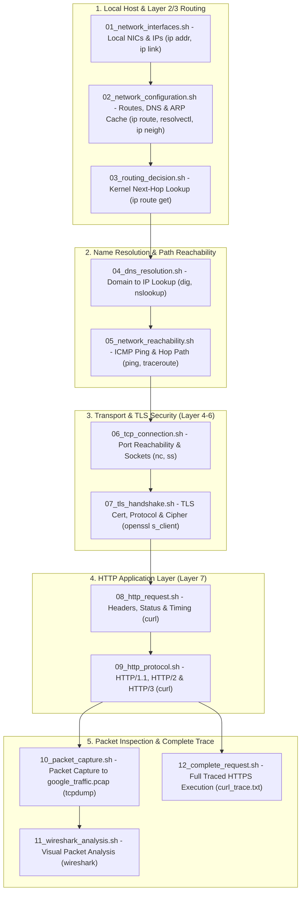

# Network Request Investigation

A Linux host makes an HTTPS request (using `google.com` and `142.251.209.78` as the example target).

Each script isolates one stage of the network stack,
from physical/virtual interfaces up through routing, DNS, TCP, TLS, HTTP, and packet-level inspection.

## What Each Stage for

| Step | Script                        | Question Answered                                                                                         | Key Commands                                             |
| ---- | ----------------------------- | --------------------------------------------------------------------------------------------------------- | -------------------------------------------------------- |
| 01   | `01_network_interfaces.sh`    | Which network interfaces exist, are they UP, and what IPs are assigned?                                   | `ip -br addr`, `ip link show`                            |
| 02   | `02_network_configuration.sh` | Where does default traffic go, which DNS servers are configured, and which L2 neighbors are cached?       | `ip route`, `resolvectl status`, `ip neigh`              |
| 03   | `03_routing_decision.sh`      | Which interface, source IP, and gateway will the kernel pick for `142.251.209.78`?                        | `ip route get 142.251.209.78`                            |
| 04   | `04_dns_resolution.sh`        | How does `google.com` resolve across IPv4 (`A`), IPv6 (`AAAA`), `NS`, local DNS, and `8.8.8.8`?           | `dig`, `nslookup`                                        |
| 05   | `05_network_reachability.sh`  | Is the destination reachable over ICMP and which router hops lie along the path?                          | `ping -c 4`, `traceroute`                                |
| 06   | `06_tcp_connection.sh`        | Can a TCP connection open on ports `443` and `80`, and what local sockets are active?                     | `nc -vz`, `ss -tn`, `sudo ss -tulpn`                     |
| 07   | `07_tls_handshake.sh`         | How does the TLS handshake succeed, what certificate is served, and which protocol/cipher are negotiated? | `openssl s_client`, `openssl x509`                       |
| 08   | `08_http_request.sh`          | What do the HTTP headers, status code, and per-phase timing breakdown look like?                          | `curl -v`, `curl -I`, `curl -i`, `curl -w`               |
| 09   | `09_http_protocol.sh`         | How does the server behave across HTTP/1.1, HTTP/2, and HTTP/3?                                           | `curl -I --http1.1`, `--http2`, `--http3`                |
| 10   | `10_packet_capture.sh`        | What raw TCP/SYN/ACK packets cross the wire for `142.251.209.78`?                                         | `sudo tcpdump` (`-D`, filters, `-w google_traffic.pcap`) |
| 11   | `11_wireshark_analysis.sh`    | How do those captured packets look visually with Wireshark display filters?                               | `wireshark google_traffic.pcap`                          |
| 12   | `12_complete_request.sh`      | What does one complete traced HTTPS request look like from DNS lookup to final byte?                      | `curl -v --trace-time --trace-ascii curl_trace.txt`      |
